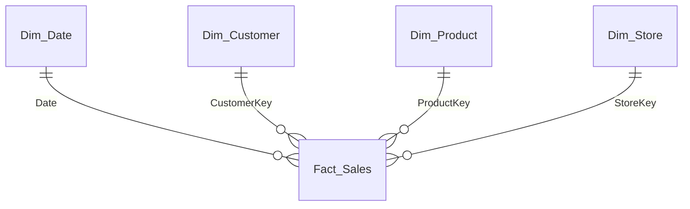

# Modeling patterns

## Role-playing dimensions

A single `Dim_Date`, several relationships to the fact; only one active.

```
Dim_Date[Date] 1 ──→ * Fact_Sales[OrderDate]     (active)
Dim_Date[Date] 1 ··→ * Fact_Sales[DeliveryDate]  (inactive)
```

```dax
Net Sales by Delivery Date =
CALCULATE (
    [Net Sales],
    USERELATIONSHIP ( Dim_Date[Date], Fact_Sales[DeliveryDate] )
)
```

If users must filter on both dates at once in the same visual, create a copy `Dim_Date Delivery` (calculated table or Power Query query) rather than multiplying measures.

## SCD

- **Type 1**: the attribute is overwritten; no history. Default.
- **Type 2**: a new row at each change.

| CustomerKey | CustomerCode | Region | StartDate | EndDate | IsCurrent |
|---|---|---|---|---|---|
| 101 | C-0042 | North | 2024-01-01 | 2025-06-30 | False |
| 245 | C-0042 | West | 2025-07-01 | 9999-12-31 | True |

The fact references the `CustomerKey` valid at the date of the event (resolved upstream, in the ETL). Count customers with `DISTINCTCOUNT ( Dim_Customer[CustomerCode] )`, not the surrogate key.

## Many-to-many

Prefer a **bridge table** to a native `*:*` relationship:

```
Dim_Customer 1 → * Bridge_CustomerAccount * ← 1 Dim_Account 1 → * Fact_Balances
```

- The `Dim_Customer → Bridge` relationship must propagate the filter to `Dim_Account`: either a bidirectional relationship **limited to that segment**, or explicit filtering in the measure:

```dax
Customer Balance =
CALCULATE (
    [Balance],
    CROSSFILTER ( Bridge_CustomerAccount[AccountKey], Dim_Account[AccountKey], BOTH )
)
```

- Totals are not additive (a shared account is counted once in the total): document it in the measure's description.

## Different grains

Budget by month, sales by day (`[Sales Target]` on `Fact_Budget`, `[Net Sales]` on `Fact_Sales`): link `Fact_Budget` to a month-grain dimension (or to `Dim_Date` through a `FirstDayOfMonth` column related on the date of the 1st of the month) and never show the budget at day level without an explicit allocation rule.

## Header / detail

Flatten: carry the header attributes (customer, channel, date) onto each detail line. Header amounts (shipping costs) are either allocated pro rata to the lines, or stored in a separate fact table at order grain.

## Junk and degenerate dimensions

- **Degenerate**: invoice number left in the fact (no dedicated dimension).
- **Junk**: group low-cardinality flags (`IsPromo`, `WebChannel`, `PaymentMethod`) in a `Dim_Profile` with a key, rather than leaving them as text columns in a large fact.

## Typical Mermaid diagram


